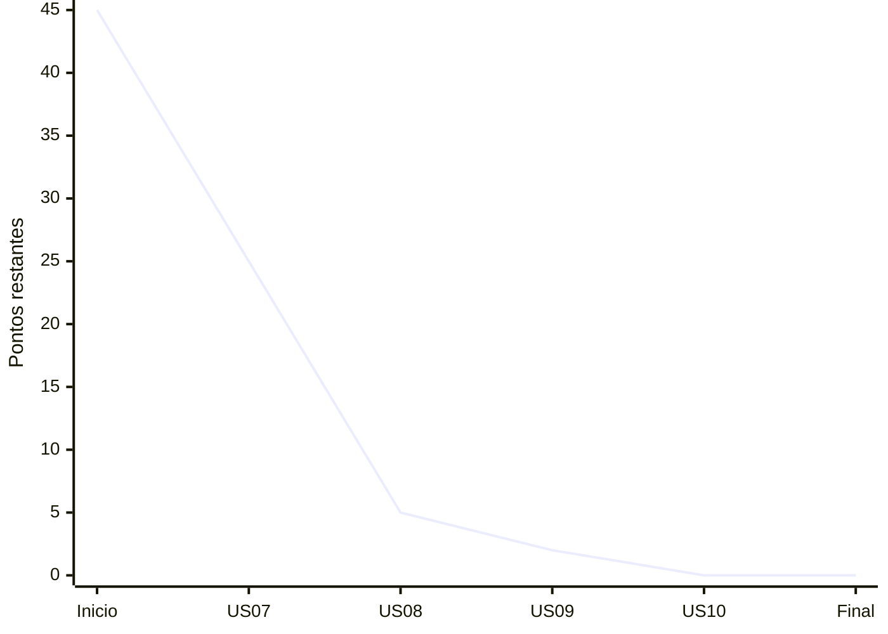

# UNIVERSIDADE CATÓLICA DE PERNAMBUCO

## GRADUAÇÃO EM CIÊNCIA DA COMPUTAÇÃO

**Autores:**
- HEITOR JOSÉ GONDIM BRITO
- JOÃO GABRIEL GOMES DE SOUSA
- JOÃO PEDRO CALAÇA VASCONCELOS
- VITOR ARAÚJO PACHECO DE MIRANDA

---

# GREENMIFY
## ENTREGA 5 – MÉTRICAS E DESEMPENHO DO PROCESSO

**Recife — 2026**

---

## Apresentação do trabalho

Trabalho apresentado à disciplina de Processos e Requisitos de Software, do curso de Ciência da Computação da Universidade Católica de Pernambuco, como requisito para avaliação da disciplina.

**Professora:** Ivna Cristine Brasileiro Valença

**Recife — 2026**

---

## 1. Objetivo

Analisar o desempenho do processo de desenvolvimento do Greenmify ao longo das seis Sprints, utilizando métricas para avaliar a produtividade da equipe, identificar gargalos, observar variações no fluxo de trabalho e propor melhorias.

A análise considera principalmente a quantidade de Story Points planejados e concluídos, a velocity e os dados de Burndown de cada Sprint.

## 2. Sobre o projeto

O Greenmify é um marketplace digital voltado ao setor agrícola, desenvolvido com o objetivo de conectar produtores rurais e consumidores em uma plataforma para divulgação, pesquisa e comercialização de produtos e equipamentos agrícolas.

O projeto possui 20 histórias de usuário organizadas em seis épicos:

- **E01:** Busca e descoberta de produtos.
- **E02:** Visualização e informações dos produtos.
- **E03:** Cadastro e gerenciamento de produtos.
- **E04:** Comunicação entre consumidor e vendedor.
- **E05:** Gerenciamento de usuários e perfis.
- **E06:** Moderação e segurança.


## 3. Métricas utilizadas

Para avaliar o desempenho do processo, foram utilizadas as seguintes métricas:

- Story Points planejados;
- Story Points concluídos;
- Velocity;
- Percentual de conclusão;
- Burndown Chart.

## 4. Dados coletados nas Sprints

As seis Sprints foram organizadas considerando os épicos e as histórias de usuário do Greenmify.

### 4.1 Sprint 1

**Épico:** E03 – Cadastro e Gerenciamento de Produtos.

| ID | História | Story Points | Status |
|---|---|---:|---|
| US07 | Cadastrar produtos agrícolas | 20 | Concluída |
| US08 | Cadastrar equipamentos agrícolas | 20 | Concluída |
| US09 | Editar produtos | 3 | Concluída |
| US10 | Alterar disponibilidade dos produtos | 2 | Concluída |
| **Total** | | **45** | |

- **Planejado:** 45 pontos.
- **Concluído:** 45 pontos.
- **Restante:** 0 pontos.
- **Percentual de conclusão:** 100%.

### 4.2 Sprint 2

**Épico:** E01 – Busca e Descoberta de Produtos.

| ID | História | Story Points | Status |
|---|---|---:|---|
| US01 | Pesquisar produtos agrícolas | 8 | Concluída |
| US02 | Filtrar produtos | 5 | Concluída |
| US03 | Favoritar produtos | 3 | Concluída |
| **Total** | | **16** | |

- **Planejado:** 16 pontos.
- **Concluído:** 16 pontos.
- **Restante:** 0 pontos.
- **Percentual de conclusão:** 100%.

### 4.3 Sprint 3

**Épico:** E02 – Visualização e Informações dos Produtos.

| ID | História | Story Points | Status |
|---|---|---:|---|
| US04 | Visualizar informações do produto | 8 | Concluída |
| US05 | Visualizar perfil do produtor | 5 | Concluída |
| US06 | Comparar produtos | 5 | Concluída |
| **Total** | | **18** | |

- **Planejado:** 18 pontos.
- **Concluído:** 18 pontos.
- **Restante:** 0 pontos.
- **Percentual de conclusão:** 100%.

### 4.4 Sprint 4

**Épico:** E04 – Comunicação entre Consumidor e Vendedor.

| ID | História | Story Points | Status |
|---|---|---:|---|
| US11 | Entrar em contato com o produtor | 8 | Concluída |
| US12 | Receber mensagens | 5 | Concluída |
| US13 | Visualizar conversas | 5 | Concluída |
| **Total** | | **18** | |

- **Planejado:** 18 pontos.
- **Concluído:** 18 pontos.
- **Restante:** 0 pontos.
- **Percentual de conclusão:** 100%.

### 4.5 Sprint 5

**Épico:** E05 – Gerenciamento de Usuários e Perfis.

| ID | História | Story Points | Status |
|---|---|---:|---|
| US14 | Criar uma conta | 8 | Concluída |
| US15 | Editar dados do perfil | 5 | Concluída |
| US16 | Completar perfil de produtor | 5 | Concluída |
| **Total** | | **18** | |

- **Planejado:** 18 pontos.
- **Concluído:** 18 pontos.
- **Restante:** 0 pontos.
- **Percentual de conclusão:** 100%.

### 4.6 Sprint 6

**Épico:** E06 – Moderação e Segurança.

| ID | História | Story Points | Status |
|---|---|---:|---|
| US17 | Visualizar anúncios | 3 | Concluída |
| US18 | Aprovar ou reprovar anúncios | 8 | Concluída |
| US19 | Denunciar anúncios inadequados | 5 | Concluída |
| US20 | Remover anúncios inadequados | 4 | Concluída |
| **Total** | | **20** | |

- **Planejado:** 20 pontos.
- **Concluído:** 20 pontos.
- **Restante:** 0 pontos.
- **Percentual de conclusão:** 100%.

## 5. Registro de Bugs e Mudanças de Requisitos

Durante o desenvolvimento da Sprint 1, foram identificados um bug e uma necessidade de alteração nos requisitos relacionados às funcionalidades de cadastro de produtos agrícolas e equipamentos.

### 5.1 BUG01 – Problema no cadastro de produtos e equipamentos

- **Histórias relacionadas:** US07 e US08.
- **Épico:** E03 – Cadastro e Gerenciamento de Produtos.
- **Descrição:** Foi identificado um problema relacionado ao processo de cadastro de produtos agrícolas e equipamentos.
- **Situação:** Identificado e registrado para correção.

### 5.2 MUD01 – Unificação do cadastro e inclusão de unidade de medida

- **Histórias relacionadas:** US07 e US08.
- **Épico:** E03 – Cadastro e Gerenciamento de Produtos.
- **Descrição:** Foi proposta a unificação dos cadastros de produtos agrícolas e equipamentos, mantendo os campos específicos de cada tipo. Também foi solicitada a inclusão do campo "Unidade de medida" no cadastro de produtos, permitindo opções como kg, unidade, caixa, litro e tonelada.
- **Situação:** Mudança aceita pela equipe, com implementação planejada.

## 6. Análise da Velocity

A velocity foi utilizada para avaliar a quantidade de trabalho concluída em cada Sprint.

### 6.1 Resultado por Sprint

| Sprint | Story Points planejados | Story Points concluídos | Velocity | Conclusão |
|---|---:|---:|---:|---:|
| Sprint 1 | 45 | 45 | 45 | 100% |
| Sprint 2 | 16 | 16 | 16 | 100% |
| Sprint 3 | 18 | 18 | 18 | 100% |
| Sprint 4 | 18 | 18 | 18 | 100% |
| Sprint 5 | 18 | 18 | 18 | 100% |
| Sprint 6 | 20 | 20 | 20 | 100% |
| **Total** | **135** | **135** | **135** | **100%** |

### 6.2 Interpretação dos resultados

A Sprint 1 apresentou a maior velocity, com 45 Story Points concluídos. Nas Sprints seguintes, a quantidade de pontos planejados ficou entre 16 e 20, e todas as histórias também foram concluídas.

Todas as seis Sprints apresentaram 100% de conclusão do trabalho planejado, indicando que a equipe conseguiu finalizar as atividades previstas em cada ciclo.

A diferença entre a velocity da primeira Sprint e das demais está relacionada principalmente à quantidade e à complexidade das histórias selecionadas. Por isso, a comparação deve considerar também o planejamento e o tamanho das atividades, não apenas o número de pontos.

Considerando as seis Sprints, foram planejados e concluídos 135 Story Points, correspondendo a 100% do total.

A média de velocity das seis Sprints foi de 22,5 Story Points.

## 7. Análise dos gráficos de Burndown

Os gráficos de Burndown permitem visualizar a redução dos pontos restantes conforme as histórias são concluídas.

### 7.1 Sprint 1

| Momento | Pontos restantes |
|---|---:|
| Início da Sprint | 45 |
| US07 concluída | 25 |
| US08 concluída | 5 |
| US09 concluída | 2 |
| US10 concluída | 0 |
| Final da Sprint | 0 |

**Gráfico:**



**Análise:**

A Sprint começou com 45 pontos restantes. Após a conclusão da US07, o valor caiu para 25 pontos. Com a conclusão da US08, chegou a 5 pontos.

Em seguida, a conclusão da US09 reduziu o restante para 2 pontos. Com a conclusão da US10, todos os pontos planejados foram finalizados.

O resultado demonstra que todas as histórias selecionadas para a Sprint foram concluídas.

### 7.2 Sprint 2

| Momento | Pontos restantes |
|---|---:|
| Início da Sprint | 16 |
| US01 concluída | 8 |
| US02 concluída | 3 |
| US03 concluída | 0 |
| Final da Sprint | 0 |

**Gráfico:**

```mermaid
xychart-beta
    x-axis ["Inicio", "US01", "US02", "US03", "Final"]
    y-axis "Pontos restantes" 0 --> 16
    line [16, 8, 3, 0, 0]
```

**Análise:**

A Sprint começou com 16 pontos restantes. A conclusão das histórias US01 e US02 reduziu progressivamente o trabalho pendente.

Com a conclusão da US03, todos os pontos planejados foram finalizados.

O resultado demonstra que todas as funcionalidades selecionadas foram concluídas.

### 7.3 Sprint 3

| Momento | Pontos restantes |
|---|---:|
| Início da Sprint | 18 |
| US04 concluída | 10 |
| US05 concluída | 5 |
| US06 concluída | 0 |
| Final da Sprint | 0 |

**Gráfico:**

```mermaid
xychart-beta
    x-axis ["Inicio", "US04", "US05", "US06", "Final"]
    y-axis "Pontos restantes" 0 --> 18
    line [18, 10, 5, 0, 0]
```

**Análise:**

A Sprint começou com 18 pontos restantes. A conclusão das histórias US04 e US05 reduziu o trabalho pendente para 5 pontos.

Após a conclusão da US06, todos os pontos foram finalizados.

O resultado demonstra que o planejamento foi totalmente concluído.

### 7.4 Sprint 4

| Momento | Pontos restantes |
|---|---:|
| Início da Sprint | 18 |
| US11 concluída | 10 |
| US12 concluída | 5 |
| US13 concluída | 0 |
| Final da Sprint | 0 |

**Gráfico:**

```mermaid
xychart-beta
    x-axis ["Inicio", "US11", "US12", "US13", "Final"]
    y-axis "Pontos restantes" 0 --> 18
    line [18, 10, 5, 0, 0]
```

**Análise:**

A Sprint começou com 18 pontos restantes. A conclusão das histórias US11 e US12 reduziu o trabalho pendente para 5 pontos.

Com a conclusão da US13, todos os pontos planejados foram finalizados.

O resultado demonstra que as funcionalidades de comunicação foram concluídas dentro do escopo planejado.

### 7.5 Sprint 5

| Momento | Pontos restantes |
|---|---:|
| Início da Sprint | 18 |
| US14 concluída | 10 |
| US15 concluída | 5 |
| US16 concluída | 0 |
| Final da Sprint | 0 |

**Gráfico:**

```mermaid
xychart-beta
    x-axis ["Inicio", "US14", "US15", "US16", "Final"]
    y-axis "Pontos restantes" 0 --> 18
    line [18, 10, 5, 0, 0]
```

**Análise:**

A Sprint começou com 18 pontos restantes. A conclusão das histórias US14 e US15 reduziu o trabalho pendente para 5 pontos.

Após a conclusão da US16, não restaram pontos pendentes.

O resultado demonstra que todas as funcionalidades de gerenciamento de usuários e perfis foram concluídas.

### 7.6 Sprint 6

| Momento | Pontos restantes |
|---|---:|
| Início da Sprint | 20 |
| US17 concluída | 17 |
| US18 concluída | 9 |
| US19 concluída | 4 |
| US20 concluída | 0 |
| Final da Sprint | 0 |

**Gráfico:**

```mermaid
xychart-beta
    x-axis ["Inicio", "US17", "US18", "US19", "US20", "Final"]
    y-axis "Pontos restantes" 0 --> 20
    line [20, 17, 9, 4, 0, 0]
```

**Análise:**

A Sprint começou com 20 pontos restantes. A conclusão das histórias US17, US18 e US19 reduziu progressivamente o trabalho pendente.

Com a conclusão da US20, todos os pontos planejados foram finalizados.

O resultado demonstra que todas as funcionalidades de moderação e segurança foram concluídas.

### 7.7 Comparação geral dos Burndowns

Nas seis Sprints, o trabalho planejado foi completamente concluído, chegando a zero pontos restantes no encerramento de cada ciclo.

Esse resultado indica que, no cenário analisado, a equipe conseguiu finalizar todas as histórias selecionadas para as Sprints.

Os gráficos apresentados utilizam os momentos de conclusão das histórias como referência. Eles representam a redução dos pontos por etapa, não registros diários de acompanhamento.

## 8. Gargalos identificados

A análise das Sprints e das retrospectivas permitiu identificar alguns pontos que podem dificultar o andamento do desenvolvimento.

### 8.1 Comunicação entre os integrantes

Na retrospectiva da Sprint 1, foi identificada a necessidade de tornar a comunicação entre os integrantes mais frequente.

A falta de comunicação durante o desenvolvimento pode dificultar o compartilhamento de informações, atrasar a identificação de problemas e prejudicar a organização das atividades.

### 8.2 Planejamento e divisão das atividades

Também foi identificada a necessidade de melhorar a divisão das atividades entre os integrantes.

Uma distribuição inadequada pode gerar concentração de tarefas em determinados membros e dificultar o cumprimento do planejamento.

### 8.3 Problema no cadastro de produtos e equipamentos

Durante a Sprint 1, foi identificado o BUG01, relacionado ao cadastro de produtos e equipamentos agrícolas.

O problema está relacionado às funcionalidades US07 e US08 e motivou o registro da mudança MUD01.

### 8.4 Necessidade de melhoria no processo de cadastro

A identificação do BUG01 e o registro da MUD01 demonstram a necessidade de revisar o processo de cadastro de produtos e equipamentos, buscando melhorar a organização dos campos e a validação das informações.

## 9. Melhorias definidas para o processo

A partir dos pontos identificados, foram definidas ações para melhorar a organização e o acompanhamento do desenvolvimento.

### 9.1 Melhorar a comunicação

Realizar acompanhamentos mais frequentes entre os integrantes para compartilhar informações sobre o andamento das tarefas e dificuldades encontradas.

### 9.2 Melhorar a divisão das atividades

Organizar melhor a distribuição das tarefas, considerando a complexidade das histórias e a disponibilidade dos integrantes.

### 9.3 Manter o acompanhamento pelo GitHub Projects

Utilizar o quadro para acompanhar a movimentação das histórias entre To Do, Doing e Done, facilitando a identificação de tarefas paradas ou atrasadas.

### 9.4 Implementação da mudança MUD01

A equipe registrou a mudança MUD01 – Unificação do cadastro e adição de unidade de medida.

A mudança foi aceita e está relacionada às histórias US07 e US08 e ao BUG01.

As alterações propostas são:

- Unificar o processo de cadastro de produtos e equipamentos.
- Manter os campos específicos de cada tipo.
- Adicionar o campo Unidade de medida ao cadastro de produtos.
- Atualizar os critérios de aceitação.
- Corrigir o BUG01.

A mudança foi registrada no GitHub Projects e teve sua implementação planejada e concluída. 

## 10. Análise do impacto das melhorias

As ações definidas buscam melhorar a organização das atividades e reduzir problemas identificados durante o desenvolvimento.

| Melhoria | Impacto esperado |
|---|---|
| Melhorar a comunicação | Reduzir falhas de entendimento e facilitar a colaboração. |
| Melhorar a divisão das atividades | Evitar concentração de tarefas e melhorar a distribuição do trabalho. |
| Acompanhar as tarefas pelo quadro | Facilitar a identificação de atrasos e atividades pendentes. |

## 11. Relatório de qualidade do processo

A qualidade do processo de desenvolvimento do Greenmify foi avaliada considerando o planejamento das Sprints, o acompanhamento das atividades, a qualidade das entregas e a identificação e resolução de problemas durante o projeto.

Ao longo das seis Sprints, todas as histórias de usuário planejadas foram consideradas concluídas, totalizando 135 Story Points. Esse resultado demonstra que, no cenário analisado, a equipe conseguiu cumprir todo o planejamento estabelecido para cada ciclo de desenvolvimento.

A utilização do GitHub Projects contribuiu para a organização e o acompanhamento das atividades, permitindo visualizar o andamento das histórias por meio dos status To Do, Doing e Done. Além disso, a equipe estabeleceu uma Definition of Done (DoD), definindo critérios para considerar uma funcionalidade concluída, como implementação, revisão do código, realização de testes, atendimento aos critérios de aceitação, atualização da documentação e validação pela equipe.

Durante o desenvolvimento, foram identificados pontos que precisavam de atenção, principalmente em relação à comunicação entre os integrantes, à divisão das atividades e ao tempo reservado para os testes. Também foi identificado o BUG01, relacionado ao cadastro de produtos e equipamentos agrícolas, que motivou a criação da MUD01. A mudança propôs a unificação do processo de cadastro e a inclusão do campo Unidade de medida, contribuindo para melhorar a organização e o funcionamento dessas funcionalidades.

O BUG01 foi corrigido e a MUD01 foi implementada, demonstrando a capacidade da equipe de identificar problemas, realizar alterações nos requisitos e aplicar melhorias no produto.

De maneira geral, o processo apresentou resultados positivos em relação ao cumprimento do planejamento, à organização das atividades e à resolução dos problemas identificados. Entretanto, é importante continuar aprimorando a comunicação, a distribuição das tarefas e o planejamento dos testes para manter a qualidade nas próximas etapas do projeto.

## 12. Conclusão

A análise das seis Sprints permitiu avaliar o desempenho do processo de desenvolvimento do Greenmify por meio das métricas de Story Points, velocity e Burndown. Os resultados demonstraram que foram planejados e considerados concluídos 135 Story Points, representando 100% do trabalho previsto no cenário adotado para o relatório.

Os gráficos de Burndown mostraram a redução dos pontos restantes durante as Sprints, chegando a zero ao final de cada ciclo. A análise também permitiu identificar oportunidades de melhoria relacionadas à comunicação entre os integrantes, à divisão das atividades e ao planejamento dos testes.

Outro resultado importante foi a identificação e correção do BUG01, além da implementação da MUD01, que promoveu melhorias no processo de cadastro de produtos e equipamentos agrícolas. Essas ações demonstram a importância de acompanhar problemas e alterações nos requisitos durante o desenvolvimento, garantindo que as necessidades identificadas sejam tratadas.

Conclui-se que a utilização de métricas contribui para compreender melhor o andamento do projeto, avaliar o cumprimento do planejamento e identificar dificuldades que podem comprometer o desenvolvimento. Dessa forma, as melhorias realizadas e as ações definidas servem como referência para aperfeiçoar a organização e a qualidade do processo de desenvolvimento do Greenmify.

## 13. Observação sobre os dados

Para a elaboração deste relatório, foram considerados os dados de planejamento e conclusão das seis Sprints, adotando o cenário em que todas as 20 histórias de usuário foram concluídas. Os valores de Story Points das Sprints 2 a 6 correspondem às estimativas utilizadas para a análise, e não a medições independentes de produtividade.

Os gráficos de Burndown foram construídos com base nos pontos restantes após a conclusão de cada história, representando a evolução do trabalho por etapas, e não registros diários de acompanhamento.

Também foram considerados o registro e a resolução do BUG01 e a implementação da MUD01. Dessa forma, as correções e melhorias relacionadas ao processo de cadastro de produtos e equipamentos foram concluídas e incorporadas ao projeto.
